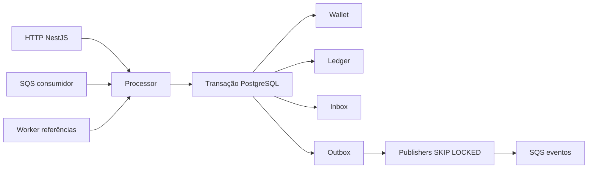

# Decisões de arquitetura

## Fluxo e fronteiras

HTTP e SQS usam `Processor.submit`. Os contratos são validados antes de abrir a transação. O domínio contém classes sem dependência de NestJS ou TypeORM; factories criam e reidratam objetos. O transporte transforma dinheiro em strings antes de persistir ou emitir eventos.



O worker de referências chama a mesma rotina financeira interna `apply`, em uma nova transação. Não chama `submit` com uma chave nova: isso criaria outra identidade em vez de retomar a operação pendente.

## Dinheiro e persistência

`Money` usa centavos em `bigint`, é congelado e imutável. A entrada aceita até duas casas, sem sinal, espaços, notação científica ou arredondamento; a saída sempre tem duas casas. Negativos são possíveis somente por operações internas e reidratação. A moeda é um código com três letras maiúsculas; as operações exigem igualdade de moeda. Não há conversão cambial nem catálogo completo de moedas ISO.

O banco usa `numeric(18,2)` e o driver `pg` devolve strings; não se instala parser para convertê-las em `number`. Isso limita o valor a 16 dígitos inteiros, verificados por `Money.scale` antes de persistir. `number` aparece somente em versões, contagens, tempos, métricas e limites de paginação.

TypeORM foi escolhido pela disponibilidade de `EntitySchema`, migrations reversíveis, `EntityManager.transaction` e locks pessimistas. A wallet tem mapeamento explícito; registros de auditoria e operações SQL específicas de PostgreSQL usam consultas parametrizadas pelo EntityManager da transação. A escolha de SQL explícito permite revisar constraints, `ON CONFLICT` e `SKIP LOCKED` sem comportamento implícito de cascatas. Não há `synchronize`, decorators de persistência no domínio ou transformação monetária dependente do ORM.

## Concorrência e garantias no schema

Isolamento `READ COMMITTED`, com `SELECT ... FOR UPDATE` na wallet antes de ler saldo ou decidir regras. Todas as decisões financeiras de uma wallet são sequenciais, mesmo em processos distintos; wallets diferentes usam linhas distintas. Não existe lock global. O worker de referências também adquire primeiro a wallet, mantendo a ordem de locks.

A aplicação calcula o lançamento pelo agregado. Um trigger de inserção do ledger adquire o lock da wallet, confere saldo anterior, montante, direção e estado da transação e atualiza o saldo materializado. A abertura preserva versão 1; outros lançamentos incrementam a versão. A aplicação não executa um segundo update de saldo.

As garantias de banco incluem:

- `UNIQUE(player_id,currency)`, chave idempotente `UNIQUE(provider_id,idempotency_key)` e identidade `UNIQUE(provider_id,external_transaction_id)`;
- uma entrada por `(wallet_id,transaction_id)` e foreign keys compostas preservando wallet e moeda;
- checks de saldo não negativo, montante positivo do ledger e aritmética do lançamento;
- triggers que proíbem alterar ou excluir ledger, inbox e transações terminais;
- identidade da wallet e payload da transação imutáveis;
- índice único parcial para **uma** reversão processada por referência;
- constraints diferidas que conferem saldo reconstruído, versão e presença/ausência de ledger antes do commit.

Assim, um update manual do saldo sem ledger correspondente também falha. Usuários administrativos capazes de desabilitar triggers estão fora do modelo de ameaça. Em produção, o usuário de aplicação não deve ser dono do schema.

Locks têm timeout de 5 segundos e statements de 15 segundos. Falhas transitórias de dependência respondem 503, deixando o provedor repetir com a mesma chave; SQS aplica retry. Não há retry HTTP invisível que possa prolongar indefinidamente uma requisição.

## Idempotência e resultados históricos

Os campos de negócio são validados e normalizados: UUIDs em minúsculas, dinheiro com escala fixa e campos opcionais ausentes omitidos. O hash é SHA-256 de JSON canônico recursivo, com chaves ordenadas lexicograficamente. Inclui provider, identificador externo, player, wallet, rodada, jogo, kind, money e referência. Header, correlation ID, campos desconhecidos e metadados de transporte não entram no hash.

Logo, `"10"` e `"10.00"` representam o mesmo payload normalizado. Usar outra chave para uma identidade externa já existente é conflito.

A chave idempotente é única **dentro do provider**, não globalmente. Dois provedores podem escolher a mesma string sem que um negue serviço ao outro; a recomendação de prefixar pelo provider continua valendo como boa prática, mas a corretude não depende dela. A consulta de replay é igualmente escopada por `provider_id`, então um replay nunca pode devolver o resultado de outro provedor.

`ON CONFLICT DO NOTHING` aguarda a decisão de inserções concorrentes; a leitura seguinte compara chave e hash persistidos. Não há cache de deduplicação em memória.

O resultado é JSON persistido com o saldo observado na operação, inclusive em rejeições. Replays não consultam o saldo atual para montar a resposta. Uma resposta pendente evolui quando o worker conclui a operação; depois de terminal fica congelada. A abertura interna pode ser consultada por seu lançamento histórico.

A inbox é única por `(consumer_name,message_id)`. Seu hash inclui tipo e dados normalizados, incluindo a chave idempotente; horários e IDs de entrega do broker não participam. Inbox e efeitos financeiros são confirmados juntos. Um conflito de inbox desfaz a operação inteira.

## Regras e transições

Transições permitidas:

```text
PENDING           → PENDING_REFERENCE | PROCESSED | REJECTED | FAILED
PENDING_REFERENCE → PENDING_REFERENCE | PROCESSED | REJECTED | FAILED
PROCESSED, REJECTED, FAILED → nenhuma
```

`FAILED` está modelado e aplicado no schema, mas **nenhum caminho de código o produz hoje**: é o estado reservado para uma operação já aceita que se mostre permanentemente inaplicável por infraestrutura. O fluxo normal de indisponibilidade faz rollback e retry, e mensagens sem contrato ou sem wallet válida não chegam a criar agregado. Mantê-lo explícito evita que uma falha futura desse tipo seja colapsada em `REJECTED`, que significa decisão de negócio.

`WIN` e `LOSS` podem chegar sem referência. Quando informada, exige uma BET processada no mesmo provider, player, wallet, moeda e rodada. `REFUND` exige BET. `ROLLBACK` aceita BET, WIN ou REFUND e inverte sua direção. Reversão parcial não é aceita. Referências rejeitadas/falhas não ficam pendentes eternamente. Referência à própria transação é rejeitada.

**Uma referência processada é revertida no máximo uma vez, por qualquer tipo de reversão.** A regra 4 do enunciado diz "pelo mesmo tipo de operação", o que lido ao pé da letra permitiria um REFUND *e* um ROLLBACK sobre a mesma BET. Essa leitura cria dinheiro: uma aposta de `10.00` devolveria `20.00`, e o pior é que o ledger continuaria internamente coerente, de modo que a reconciliação não acusaria nada. Como o enunciado também lista crédito duplicado entre as falhas eliminatórias, a invariante escolhida foi a mais forte, aplicada nos dois níveis: o índice parcial `one_reversal_per_reference` e a checagem de `ALREADY_REVERSED` ignoram o tipo. Se o contrato de um provedor realmente exigir reversões independentes por tipo, basta reintroduzir `kind` no índice e na consulta — a mudança é de uma linha em cada ponto, e passa a ser uma decisão de produto, não um descuido.

Valores zero são aceitos para todas as operações, registrados e publicados como processados; não mudam saldo, não incrementam versão e não geram ledger. LOSS nunca gera ledger, mesmo com valor positivo. Abertura zero não gera OPENING.

## Referências fora de ordem

Na ausência da referência, ou enquanto ela ainda não é terminal, a operação fica em `PENDING_REFERENCE`. A inbox já pode ser confirmada: a responsabilidade de retomada passa para o banco. Reenvios não zeram tentativas.

O agendador varre a cada segundo, em lotes de até 25, e revalida o estado depois de adquirir o lock da wallet. O backoff é `min(300, 2^tentativa)` segundos. São 12 períodos de espera (aproximadamente 33,5 minutos); na próxima tentativa sem resolução ocorre `REJECTED / REFERENCE_NOT_FOUND`, com evento. Múltiplos agendadores podem selecionar o mesmo candidato, mas somente um o aplica; os demais revalidam status e prazo sob lock. Ciclos de referência também expiram pelo limite.

## Inbox, ack, retry e shutdown

Entrada em FIFO, grupo recomendado por wallet; a correção depende do PostgreSQL. O consumidor recebe lotes e preserva a sequência por grupo. Visibility timeout de 30 segundos, renovado a cada 10 segundos enquanto processa. O ack (`DeleteMessage`) acontece após o commit. Morte nesse intervalo resulta em redelivery e replay pela inbox.

A classificação de erros do consumidor é explícita: uma falha é permanente quando é `DomainError` ou um `ApplicationError` não marcado como `retryable`. Contrato inválido e conflito de identidade vão à DLQ antes do ack, porque reentregar não muda o resultado. Indisponibilidade de infraestrutura e `WALLET_NOT_FOUND` são tratados como transitórios: a wallet pode simplesmente não ter sido criada ainda quando a primeira operação da rodada chegou, e a mesma tolerância a desordem concedida às referências vale aqui. O backoff de visibilidade é exponencial e, no quinto processamento, a mensagem vai explicitamente à DLQ. A fila tem também redrive nativo em cinco recebimentos como proteção para consumidores que morram repetidamente.

A DLQ é at-least-once: uma morte entre envio à DLQ e ack pode duplicar a mensagem. O consumidor de eventos também precisa persistir deduplicação por `eventId`. A identidade de provider recebida da fila é validada pelo mesmo contrato e pelas mesmas regras de domínio de HTTP; a fila não concede identidade de wallet ou player automaticamente.

Em SIGTERM/SIGINT, o servidor HTTP deixa de aceitar trabalho, os loops param, mensagens em andamento concluem e mensagens do lote ainda não iniciadas voltam a ficar visíveis. O pool só fecha depois de drenar HTTP e workers. O Compose concede 45 segundos; em SIGKILL ou falha irrecuperável, o timeout de visibilidade oferece recuperação.

## Eventos e publicação

O envelope é uma classe abstrata com uma subclasse concreta por evento; `eventType` e `version` ficam no tipo, não em strings no call site. Cada evento declara a interface do seu `data`, e o payload carrega `MoneyProps` em string decimal, nunca instâncias de `Money`.

`WagerTransactionProcessed`, `WagerTransactionRejected` e `WagerTransactionPendingReference` publicam a identidade completa da operação — provider, identificador externo, wallet, player, rodada, jogo, kind, status, valor, saldo observado, referência resolvida e código de falha. Isso é deliberado: um consumidor precisa decidir o que fazer sem consultar a API de volta. `WalletBalanceChanged` publica direção, valor, saldo antes e depois e `walletVersion`.

A transação financeira insere eventos na outbox; não faz chamada SQS. Cada publisher reivindica até 50 linhas com `FOR UPDATE SKIP LOCKED` e as envia em lotes de 10 por `SendMessageBatch`, marcando numa transação separada da financeira. Publishers diferentes avançam em paralelo sobre conjuntos disjuntos. Falhas parciais do lote são identificadas pelo id devolvido por SQS e continuam pendentes com backoff; o resto é marcado como publicado.

Essa reivindicação em lote existe porque uma linha por ciclo não acompanha o caminho de escrita. Com três instâncias publicando uma linha a cada 200 ms, o teto era de cerca de 15 eventos por segundo, enquanto um burst de apostas em uma wallet quente gera algumas centenas; o `wager_outbox_lag_seconds` crescia linearmente e não voltava. Com o lote, o publisher deixa de ser o gargalo e o lag passa a refletir indisponibilidade real do broker.

Uma queda antes de publicar deixa o registro disponível; uma queda depois de publicar e antes de marcar pode repetir o mesmo `eventId`. A deduplicação FIFO por eventId é apenas otimização durante sua janela. Não há promessa de exactly-once no broker, e eventos de uma wallet podem sair de ordem entre publishers — o `walletVersion` permite ao consumidor ordenar.

Falhas de publicação persistem tentativas e backoff exponencial limitado a 300 segundos, sem descartar eventos por limite de tentativas. O lock SQL é mantido durante o envio do lote, limitado por timeout de 10 segundos, o que simplifica a recuperação sem leases ao custo de uma conexão por publisher em atividade.

## Códigos de falha

| Código | Significado / ação |
|---|---|
| `INSUFFICIENT_FUNDS` | BET sem saldo; resultado terminal |
| `REVERSAL_INSUFFICIENT_FUNDS` | Reversão debitaria mais que o disponível; revisão operacional |
| `BALANCE_LIMIT_EXCEEDED` | Crédito excederia a capacidade de persistência |
| `PLAYER_MISMATCH`, `CURRENCY_MISMATCH` | Identidade ou moeda incompatível com wallet |
| `REFERENCE_NOT_FOUND` | Referência ausente ou não resolvida após o limite |
| `REFERENCE_NOT_PROCESSED` | Referência terminou rejeitada ou falha |
| `REFERENCE_SCOPE_MISMATCH` | Referência de outro player, wallet, moeda ou rodada |
| `REFERENCE_KIND_MISMATCH` | Tipo da referência não pode ser revertido por essa operação |
| `REVERSAL_AMOUNT_MISMATCH` | Valor diferente da referência |
| `ALREADY_REVERSED` | A referência já foi revertida, por REFUND ou por ROLLBACK |
| `INVALID_REFERENCE` | Autorreferência |

Erros de contrato usam `INVALID_*` e `REFERENCE_REQUIRED`. Conflitos usam `IDEMPOTENCY_CONFLICT`, `TRANSACTION_IDENTITY_CONFLICT`, `INBOX_CONFLICT` e `WALLET_ALREADY_EXISTS`.

`INFRASTRUCTURE_UNAVAILABLE` (503) autoriza retry com a mesma chave e é reservado a falhas que trazem código de driver — SQLSTATE do PostgreSQL, erro de rede, resposta do SQS. Um erro sem esse código é defeito do nosso código, e aí a resposta é `INTERNAL_ERROR` (500): reenviar a mesma requisição não resolveria, e dizer 503 ao provedor seria convidá-lo a um retry eterno. Nenhum dos dois expõe SQL ou payload; para o 500 são logados o nome e a mensagem da exceção, que são necessários para diagnóstico e não contêm o corpo da requisição.

## Autenticação e observabilidade

Autenticação foi omitida para concentrar a implementação nos critérios financeiros, conforme seção 2 do desafio. `ProviderIdentityGuard` é o ponto explícito de extensão. A evolução seria validar tokens OIDC de Keycloak/Zitadel via JWKS, issuer e audience e vincular o claim de identidade a `providerId`; autorização de abertura/consulta de wallets teria escopo próprio. Health é separado do guard. Não existe tabela própria de senhas.

Logs JSON incluem IDs de correlação, mensagem, transação, wallet e provider, além do código de falha das rejeições, sem valores financeiros ou payloads completos. Métricas Prometheus cobrem status, duplicatas, retries, DLQ explícita, conflitos de locks, latência, lag da outbox e divergências de reconciliação. As séries com label são pré-inicializadas em zero, para que um alerta não dependa da primeira ocorrência para existir. O contador local de DLQ não observa redrives nativos; em produção seria combinado com métricas do SQS. Métricas em memória são por instância e reiniciam com o processo; não são garantias de consistência.

Reconciliação adquire o mesmo lock da wallet para comparar um estado consistente. Divergências são retornadas, logadas e contadas; nunca corrigidas automaticamente. Liveness verifica processo, readiness consulta banco e as três filas.

## Limites conhecidos

As constraints diferidas reconstroem o ledger por wallet em cada commit financeiro. Isso oferece verificação forte e legível, mas tem custo linear no histórico da wallet; para grande escala seria preciso estudar invariantes incrementais e reconciliação assíncrona sem enfraquecer as garantias. A wallet é a unidade de contenção intencional.

O cursor do ledger é base64url de um JSON com `walletId` e `sequence`, validado contra a wallet consultada. Ele é estável e inofensivo, mas não é assinado: um cliente pode forjar um cursor para pular entradas do próprio histórico. Assinar exigiria uma chave a gerenciar, o que não se justifica num endpoint sem autenticação; com um IdP no lugar, essa seria a mudança natural.

Não foram implementados IdP, double-entry, tracing distribuído, dashboard, arquivamento de auditoria ou benchmark. Não há número de throughput declarado. A implementação usa credenciais locais, um usuário de banco amplo e não pretende ser uma configuração de produção. O Compose persiste PostgreSQL; LocalStack recria filas ao subir `setup`, mas não está configurado para durabilidade do broker entre remoções de containers. Outbox já publicada depende da durabilidade oferecida pelo SQS em produção.

Referências oficiais consultadas: [transações TypeORM](https://typeorm.io/docs/transactions/), [QueryRunner](https://typeorm.io/docs/query-runner/) e [visibilidade SQS](https://docs.aws.amazon.com/AWSSimpleQueueService/latest/SQSDeveloperGuide/sqs-visibility-timeout.html).
